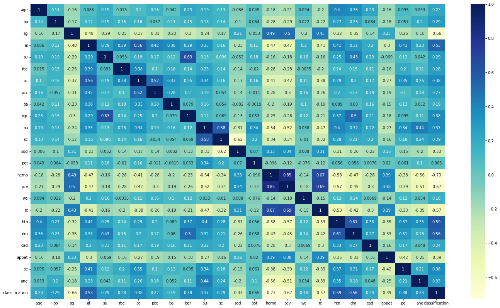
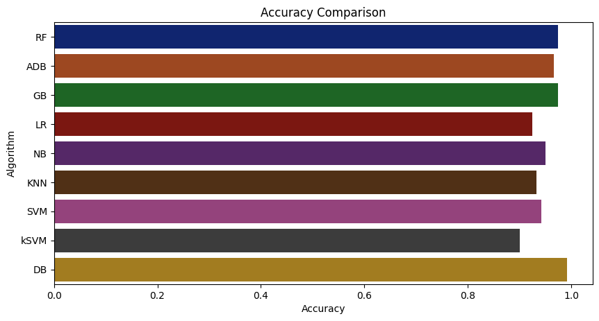
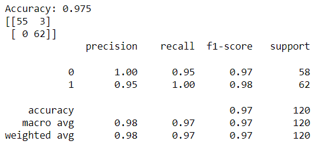

# Kidney-Disease-Prediction
The goal of this project is predit the chronic kidney disease using parameters such as Specific Gravity, Hyper Tension, Hemoglobin, Diabetes Mellitus, Albumin
, Appetite, Red Blood Cell Count, Pus Cell etc.

## Author

- [rkowdeed](https://github.com/rkowdeed)

## Description
## Domain : Healthcare
## Technology:- Machine Learning and Web Development
## Languages:- python, html, css and javascript
## Framework:- Flask 
## Libraries used:-
1. Numpy
2. Matplotlib
3. Seaborn
4. Sklearn
5. Pandas

## Run the application locally

The dependency pins in `requirements.txt` are intended for Python 3.9. From the
repository root, create and activate a virtual environment, then install the
dependencies:

```powershell
py -3.9 -m venv .venv
.\.venv\Scripts\Activate.ps1
python -m pip install --upgrade pip
python -m pip install -r requirements.txt
```

Start the Flask web application:

```powershell
python app.py
```

Open <http://127.0.0.1:5000> in a browser. The app loads the checked-in
`Kidney.pkl` model. To train the baseline model again from `Kidney_data.csv`
and replace that file, run this from the repository root:

```powershell
python model.py
python app.py
```

Keep the Flask process running while using the page. Stop it with `Ctrl+C`.

## 1. Dataset:- Kidney_data.csv
This is open source data set taken from kaggle. <br/>

Attributes in given data set:-

age - age

bp - blood pressure

sg - specific gravity

al - albumin

su - sugar

rbc - red blood cells

pc - pus cell

pcc - pus cell clumps

ba - bacteria

bgr - blood glucose random

bu - blood urea

sc - serum creatinine

sod - sodium

pot - potassium

hemo - hemoglobin

pcv - packed cell volume

wc - white blood cell count

rc - red blood cell count

htn - hypertension

dm - diabetes mellitus

cad - coronary artery disease

appet - appetite

pe - pedal edema

ane - anemia

class - class

**Attribute Information:**

We use 24 + class = 25 ( 11 numeric ,14 nominal)

Age(numerical) age in years

Blood Pressure(numerical) bp in mm/Hg

Specific Gravity(nominal) sg - (1.005,1.010,1.015,1.020,1.025)

Albumin(nominal) al - (0,1,2,3,4,5)

Sugar(nominal) su - (0,1,2,3,4,5)

Red Blood Cells(nominal) rbc - (normal,abnormal)

Pus Cell (nominal) pc - (normal,abnormal)

Pus Cell clumps(nominal) pcc - (present,notpresent)

Bacteria(nominal) ba - (present,notpresent)

Blood Glucose Random(numerical) bgr in mgs/dl

Blood Urea(numerical) bu in mgs/dl

Serum Creatinine(numerical) sc in mgs/dl

Sodium(numerical) sod in mEq/L

Potassium(numerical) pot in mEq/L

Hemoglobin(numerical) hemo in gms

Packed Cell Volume(numerical)

White Blood Cell Count(numerical) wc in cells/cumm

Red Blood Cell Count(numerical) rc in millions/cmm

Hypertension(nominal) htn - (yes,no)

Diabetes Mellitus(nominal) dm - (yes,no)

Coronary Artery Disease(nominal) cad - (yes,no)

Appetite(nominal) appet - (good,poor)

Pedal Edema(nominal) pe - (yes,no)

Anemia(nominal) ane - (yes,no)

Class (nominal) class - (ckd,notckd)

## 2. Data Cleaning
Steps followed during data cleaning:-
1. Replace categorical values into numerical values.
2. Correct the mis-spelled categorical values.
3. Drop the null values.
## 3. Exploratory Data Analysis
Steps followed in EDA:-
1. Find out correlation in data set

2. Remove correlated values and only 8 features from data set are taken
## Model training and evaluation

The notebook compares several classifiers:
1. Random Forest Algorithm
2. AdaBoostClassifier
3. GradientBoosting
4. Logistic Regression
5. Naive Bayes
6. KNN
7. Kernal SVM
8. Decision Tree


The selected features are split into 70% training and 30% test data. The
Random Forest is selected for the final model.

## Hyperparameter tuning

Hyperparameter tuning is demonstrated in
`Kidney-Disease-Prediction.ipynb` using scikit-learn's
`RandomizedSearchCV`. To run the notebook, install Jupyter and the plotting
libraries into the activated environment, then launch it:

```powershell
python -m pip install notebook matplotlib seaborn
python -m notebook Kidney-Disease-Prediction.ipynb
```

Run the notebook cells in order. The search evaluates 20 randomly selected
Random Forest configurations using 5-fold cross-validation. It searches over:

- `n_estimators`: 18 values from 100 to 2,000
- `max_features`: `auto` or `sqrt`
- `max_depth`: 5, 10, 15, 20, 25, or 30
- `min_samples_split`: 2, 5, 10, 15, 20, or 25
- `min_samples_leaf`: 1, 2, 5, 10, 12, or 15

The notebook's recorded search selected `n_estimators=435`, `max_depth=15`,
`max_features='auto'`, `min_samples_split=2`, and `min_samples_leaf=2`.
Its recorded held-out test evaluation reports **97.5% accuracy** (117 correct
predictions out of 120) with this confusion matrix, where rows are actual
classes and columns are predicted classes in the order 0, 1:

```text
[[55  3]
 [ 0 62]]
```

The notebook also prints precision, recall, and F1-score. Results can vary if
the data split, dependency versions, or search space changes. The notebook
saves a tuned estimator as `tuned_kidney_rf_model.pkl`; this is separate
from `Kidney.pkl`, which the Flask app currently loads. To serve the tuned
estimator, update the app's model path to the tuned artifact after confirming
it was generated with a compatible scikit-learn version.



## Deploy the model

The repository includes a `Procfile` for running the Flask app with Gunicorn:

```text
web: gunicorn app:app
```

Use a hosting provider that supports Python and install the packages from
`requirements.txt` before starting the web process.

## Disclaimer

This project is for educational purposes and is not a medical diagnostic tool.
Consult a qualified healthcare professional for medical advice.
